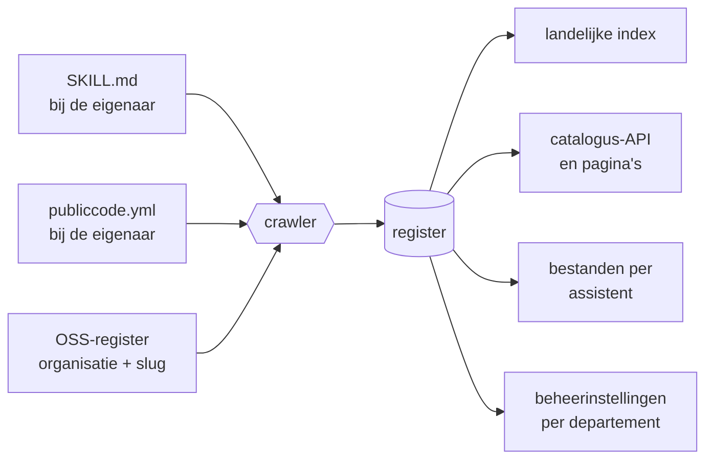

## Behandeling

Dit voorstel staat open voor reactie tot 30 november 2026, in de pull request waarin het is ingediend of via een issue op [de RFC-repository](https://github.com/developer-overheid-nl/rfcs/issues). Wie daar niet komt, mag ook mailen naar het contactadres van developer.overheid.nl; een reactie hoeft niet meer te zijn dan één alinea over één punt.

Vaststellen doen de beheerders van developer.overheid.nl, volgens het proces in RFC-0000, en niet eerder dan nadat één organisatie buiten de eigen kring de route heeft gelopen. Zij leggen bij het samenvoegen vast wat er met elke reactie is gedaan. Na vaststelling bindt dit document het register zelf; voor publicerende organisaties is het richtinggevend.

Een lichte procedure, passend bij een voorstel dat niemand iets oplegt. Groeit het register uit tot een voorziening waar organisaties op leunen, dan hoort de vaststelling naar een bestuurlijk verband te verhuizen; dat raakt het laatste open besluit achterin.

Wie niet reageert, stemt nergens mee in. Het voorstel wordt vastgesteld met de reacties die er dan liggen, en dit document legt geen organisatie iets op die er niet zelf voor kiest.

Wat het niet regelt: of het register er komt en wie het betaalt. Dat is een besluit van de Nederlandse Digitale Dienst en het staat hier niet als afgedaan. Het voorstel beschrijft de afspraak die nodig is als het er komt, en is zo opgezet dat de conventie ook zonder register bruikbaar blijft.

## In het kort

Voor wie het voorstel wil wegen zonder de uitwerking te lezen.

**Het probleem.** Ambtenaren gebruiken steeds vaker een AI-assistent. Zo'n assistent kent de kaders van de overheid niet, tenzij iemand ze hem geeft. Een agent-skill is precies dat: een kort document met instructies dat de assistent erbij pakt zodra het onderwerp langskomt. Wie een API bouwt, krijgt de API Design Rules aangereikt. Die instructies worden nu op tientallen plekken los van elkaar geschreven. Niemand kan zien of een instructie nog klopt met de regel die hij beschrijft, wie ervoor verantwoordelijk is, of hoe je hem terughaalt als hij niet meer deugt.

**Het voorstel.** Elke organisatie schrijft haar instructies in haar eigen repositories en blijft eigenaar. Een landelijk register bij de Nederlandse Digitale Dienst haalt ze op, controleert de vorm en maakt ze vindbaar. Het register toetst de inhoud niet en verklaart niets goedgekeurd. Inhoud en register zijn leveranciersneutraal; wat een specifieke assistent nodig heeft, wordt eruit gegenereerd.

**Wat het kost.** Voor een organisatie die publiceert: een dag of twee om een skill te schrijven, daarna een paar uur per jaar om hem bij te houden, plus een halve dag om zich eenmalig aan te sluiten. Voor het register: weken bouwen en daarna dagen per jaar, omdat de crawler en het organisatieregister er al zijn. Wie dat draagt is nog niet belegd; dat is het eerste open besluit achterin.

**Wat het vraagt.** Nu alleen een reactie, voor 30 november 2026, desnoods één alinea over één punt. Later, van een organisatie die wil publiceren: aansluiten bij het bestaande register voor opensourcecode, en een vaste afkorting aanvragen. Dit document legt niemand iets op, en wie niet reageert stemt nergens mee in.

**Wat het niet regelt.** Of het register er komt en wie het betaalt. Of hier een wettelijke grondslag onder moet. Wie de schade draagt wanneer een ambtenaar afgaat op een instructie die niet klopt. Die staan achterin bij de open besluiten, en de laatste is de reden om ze te nemen voordat er gebouwd wordt.

**Als we niets doen.** Dan begint elke organisatie haar eigen catalogus, komt dezelfde instructie in vijf varianten voor, en is er geen manier om een ingetrokken instructie terug te halen bij wie hem al gebruikt.

**Waarom nu en niet later.** Wat zo'n afspraak precies moet regelen, blijkt uit het bouwen en gebruiken ervan. De knelpunten in dit voorstel kwamen niet uit een ontwerp maar uit een catalogus die draait. Daarom staat hier een werkende voorziening met een kleine kring, en geen traject dat begint met financiering en mandaat. Er hangt een datum aan: zijn er op 1 november 2027 geen vijf organisaties buiten de eigen kring, dan stopt het register in deze vorm.

## Begrippen

Zeven termen die in de uitwerking terugkomen.

| Term | Betekenis |
| --- | --- |
| repository | de map op internet waarin een organisatie haar code en documenten bijhoudt, met een geschiedenis van alle wijzigingen |
| SKILL.md | het tekstbestand met de instructie zelf |
| frontmatter | het kopje bovenaan zo'n tekstbestand waarin de kenmerken staan, zoals status en datum |
| publiccode.yml | een bestaand, internationaal afgesproken bestand waarin een overheidsorganisatie beschrijft wat er in een repository staat |
| crawler | het programma dat de repositories van aangesloten organisaties langsloopt en ophaalt wat het vindt |
| slug | de vaste, korte afkorting van een organisatie, die voor elke naam van haar instructies komt te staan |
| controlegetal | een getal dat uit een bestand wordt berekend, waarmee een ontvanger kan nagaan of het onderweg is veranderd |

## Waarom nu

Het probleem is zichtbaar in het experiment dat er al ligt. Op developer.overheid.nl staat sinds dit jaar een catalogus met zeven plugins en een stuk of vijftig skills, over onder meer de Logius-standaarden, de geo-standaarden van Geonovum, internet.nl en NeRDS. Bruikbaar, en het laat meteen zien wat er misgaat zodra meer partijen meedoen.

Drie dingen die daar nu al zichtbaar zijn:

- Niets belet twee repositories dezelfde catalogusnaam te claimen. Gebeurt dat, dan vervangt wie beide toevoegt stilletjes de ene door de andere, en er is geen partij die zo'n botsing opmerkt of oplost.
- De status van een skill staat als het woord CONCEPT vooraan de omschrijving, vandaag bij drie van de zeven plugins. Daar kan geen enkel systeem op filteren, en de omschrijving is juist het veld waarmee een assistent bepaalt of een skill van toepassing is.
- De inhoud over Logius en Geonovum wordt beheerd door developer.overheid.nl, met een disclaimer dat het niet van hen is. Voor een experiment werkt dat. Als register is het onhoudbaar: de beheerder is aansprakelijk voor inhoud die hij niet kan onderhouden, en de echte eigenaar heeft geen route om het over te nemen.

Dit zijn geen fouten in het experiment. Het zijn de dingen die een experiment nooit oplost en een afspraak wel.

## Wat een agent-skill is

Een map met een tekstbestand erin, plus eventueel een script of een voorbeeld.

Het tekstbestand heet SKILL.md. Bovenaan staan een naam en een zin die zegt wanneer de skill nodig is. Daaronder staan de instructies zelf, in gewone taal. De assistent leest alleen die ene zin mee tijdens een gesprek. Past het onderwerp, dan pakt hij het hele document erbij. Past het niet, dan blijft het dicht.

Een skill is in de kern tekst: er zit geen koppeling in en er worden geen gegevens uitgewisseld.

Een skill mág wel scripts meeleveren, en de specificatie laat aan het product over of en wanneer die draaien. Wie een skill met scripts publiceert of toelaat, kan er dus niet van uitgaan dat er een toestemmingsvraag tussen zit. Daarom kijkt een review niet alleen naar de tekst maar ook naar wat zij meebrengt, en beoordeelt het register scripts niet en voert ze niet uit.

Dat maakt het makkelijk en riskant: iedereen die een werkproces kent kan er een schrijven, en een verkeerde instructie ziet er net zo betrouwbaar uit als een goede. Vandaar dit voorstel: niet om het schrijven te bemoeilijken, maar om herkomst en geldigheid vast te leggen.

De eerste skills gaan over ontwikkelen, omdat daar de vraag als eerste opkwam: API Design Rules, Digikoppeling, geo-standaarden, toegankelijkheid. Maar een instructie over een Woo-verzoek, een subsidieaanvraag of de huisstijl van een beschikking heeft dezelfde vorm en dezelfde behoefte aan herkomst en geldigheid. Dit voorstel gaat over alle werkinstructies die een overheidsorganisatie aan een assistent meegeeft.

Eén beperking hoort daarbij. Vakwerk gaat over openbare skills, want het loopt over publieke repositories en een openbaar register. Wat niet openbaar mag zijn, hoort er niet in. Een organisatie die interne werkinstructies wil verspreiden, gebruikt dezelfde vorm in haar eigen omgeving: de afspraken in dit document werken daar net zo goed, alleen zonder landelijke index.

## Uitgangspunten

Vijf keuzes die de rest van dit document bepalen. Ze staan hier zodat een lezer die verder niets leest, weet waar hij ja of nee tegen zegt.

1. **De publicerende organisatie is eigenaar.** Wie een regel beheert, beheert de skill erover. Het register neemt inhoud niet over en spreekt zich niet uit over de juistheid ervan.
2. **Het register haalt op, het ontvangt niet.** Organisaties publiceren in hun eigen repositories. Het register haalt op, net zoals het nu al API-beschrijvingen en opensourcecode ophaalt. Er is geen uploadformulier en geen centrale redactie.
3. **Eén bron, gegenereerde afgeleiden.** Alles wat een specifieke assistent nodig heeft, wordt gegenereerd. Handmatig bewerken van een gegenereerd bestand is een fout die de controle in de bouwstraat tegenhoudt.
4. **We volgen concept-specificaties waar nog geen standaard bestaat.** Voor dit onderwerp bestaan nog geen vastgestelde standaarden. Waar we een concept volgen, staat dat er met de reden bij. Wie hier nee tegen zegt, zegt: wacht tot er een standaard is. Waarom we dat niet doen, staat in het volgende punt.
5. **We bouwen om te leren, in plaats van eerst vast te leggen.** Hier staat een werkende voorziening met een kleine kring, geen traject dat begint met financiering en mandaat. Wie hier nee tegen zegt, wil eerst de afspraak rond hebben; waarom we het andersom doen, staat bij Invoering.

In de rest van dit document betekent moet een eis en kan een mogelijkheid.

## Wie doet wat

**De publicerende organisatie** schrijft, beheert, stelt vast en trekt in. Zij is aansprakelijk voor de inhoud en noemt een contactadres. Zij bepaalt zelf haar reviewproces.

**Het register**, belegd bij de Nederlandse Digitale Dienst als onderdeel van developer.overheid.nl, haalt op, controleert op vorm, publiceert en bewaart. Het toetst niet inhoudelijk.

Twee bevoegdheden heeft het wel, en beide zijn mechanisch. Het weigert een skill die niet aan de vormeisen voldoet, en het weigert een skill met een voorvoegsel dat niet hoort bij de organisatie onder wie de repository valt. Dat zijn controles die een machine uitvoert en die een organisatie zelf kan nadraaien voordat zij publiceert.

Een deelnemer die de afspraken herhaaldelijk niet nakomt, kan het register uitsluiten van opname. Dat gebeurt niet stilletjes: het register meldt schriftelijk wat er mis is en geeft dertig dagen om het te herstellen, uitsluiting wordt openbaar vastgelegd met de reden, en zij eindigt zodra de reden is weggenomen. Omdat dit document voor publicerende organisaties richtinggevend is en niet bindend, gaat het hier om toegang tot het register en om niets anders: een uitgesloten organisatie publiceert gewoon door op haar eigen domein.

**De plaats van het register** volgt uit dat bereik. De techniek staat bij developer.overheid.nl: daar draaien de crawler, het OSS-register en de linters waar dit voorstel op leunt, en daar wordt het dus gebouwd. Het eigenaarschap hoort bij de Nederlandse Digitale Dienst, waar developer.overheid.nl zelf ook onder komt. Presenteer je dit als een product van het ontwikkelaarsportaal, dan herkent een uitvoeringsorganisatie zich er niet in en begint zij haar eigen catalogus.

**De gebruikende organisatie** bepaalt zelf welke skills haar mensen mogen installeren, houdt bij wat er bij haar draait, en blijft verantwoordelijk voor wat haar mensen met een advies doen. Wat dat praktisch betekent, staat in een eigen hoofdstuk hieronder.

Drie dingen doet het register nadrukkelijk niet. Het beheert geen inhoud van anderen. Het verklaart geen enkele skill juist of goedgekeurd. Het is geen verplichte doorgang: een organisatie mag haar skills ook alleen op haar eigen domein publiceren en niet meedoen aan het landelijke overzicht.

Het register kan wel weigeren, uitsluiten en in één omschreven geval ingrijpen; wat dat precies is en welke waarborgen erbij horen, staat bij Risico en verantwoordelijkheid.

## Meedoen

Meedoen staat open voor elke organisatie die op organisaties.overheid.nl staat, het criterium dat het OSS-register vandaag al hanteert, inclusief de regel dat werk in opdracht onder de opdrachtgever valt. Wie is aangesloten, doet mee zodra er een slug is toegekend. Er komt geen aparte aanmeldprocedure en geen tweede lijst.

De drempel is niet nul: een aansluiting, een slug, een geldige publiccode.yml en een mapnaam met voorvoegsel. Voor een team van twee is dat merkbaar, en daarom levert het register een sjabloon in de repository-templates waarin dat al goed staat. Een organisatie kan haar skills ook onderbrengen bij een koepel, zoals nu met code al gebeurt.

Voordat een skill boven concept uitkomt, test de eigenaar hem met minstens twee assistenten, waarvan één open source of Europees. Een instructie die maar bij één product werkt, is een productconfiguratie en geen werkinstructie.

**Wat het kost.** Een skill schrijven is een dag of twee voor wie de stof kent; een skill overnemen die een ander schreef kost een dag voor de eerste review, werk dat een beheerorganisatie niet begroot heeft. Het onderhoud is een paar uur per jaar: de herzieningsdatum bewaken, kijken of de standaard is gewijzigd, de versie ophogen. Er is geen aparte financiering voor; dit hoort bij het beheer van de standaard, zoals de documentatie erbij hoort. Gebeurt dat onderhoud niet, dan vervalt de skill en blijft hij zichtbaar als niet meer geldig.

Het register zelf bouwt voort op een crawler, een organisatieregister en linters die er al draaien, dus het is een uitbreiding en geen nieuwe voorziening. Het werk zit in de crawler die skills herkent, de opslag en herpublicatie, de index en de catalogus-API, de generatoren per assistent en de controles op vorm en voorvoegsel. Daarnaast doorlopend beheer: meldingen afhandelen, slugs uitgeven, botsingen oplossen en bovenstroomse voorstellen bijhouden. Het bouwen is werk van weken en het draaiend houden een kwestie van dagen per jaar, zolang het aantal deelnemers klein blijft. Wie dat draagt is het eerste open besluit achterin.

## De gebruikende organisatie

De meeste organisaties publiceren niets en gebruiken alleen. Voor hen geldt het volgende.

**Wat je krijgt.** Een catalogus met per skill de eigenaar, de bron, wie hem heeft vastgesteld, de herzieningsdatum en of er generatieve AI bij is gebruikt. Daarbij een controlegetal om na te rekenen wat je binnenhaalt, een diff per skill, een wijzigingslogboek als feed, en kant-en-klare beheerinstellingen per departement.

**Wat je zelf doet.** Drie dingen, en ze volgen uit de grenzen hierboven. De status staat niet in de landelijke index, dus alleen `stable` toelaten is beleid met een eigen lijst en geen knop die je omzet. Een intrekking bereikt je werkplekken niet vanzelf, want het register stopt met uitleveren en haalt niets terug. En omdat het register niet weet wat er bij jou draait, hou je die inventaris zelf bij; het wijzigingslogboek is de bron waarmee je hem periodiek naloopt.

**Wat je van je leverancier vraagt.** Dat een beheerder kan instellen dat alleen catalogi van eigen domeinen worden toegevoegd, en hoe vaak de assistent de index herleest, want dat bepaalt hoe snel een intrekking aankomt. Dat is een eigenschap van dat product en geen garantie van dit register, dus het hoort in je inkoopvoorwaarden.

**Wat je tegen je mensen zegt.** Een skill is een samenvatting en niet de regel zelf, ook bij status `stable`. Wie op grond van een instructie een besluit neemt, blijft daar zelf verantwoordelijk voor. Zie je een fout, dan gaat die naar de eigenaar, die met contactadres in de catalogus staat.

Stopt het register in 2027, dan blijft wat je hebt geïnstalleerd gewoon werken: het zijn bestanden op een schijf. Wat vervalt is de aanvoer van nieuwe versies.

## Overdracht

Het portaal beheert nu skills over standaarden van Logius en Geonovum. Dat is tijdelijk, want een register dat andermans inhoud beheert, botst met het uitgangspunt dat het portaal geen voorkeursbehandeling geeft aan standaarden van specifieke organisaties.

**Aanbieden.** Het portaal benadert de eigenaar schriftelijk, met de skill erbij, wat er van haar verwacht wordt en wat het kost. Zij heeft drie maanden om te antwoorden. Zolang een antwoord uitblijft verandert er niets, ook niet aan het onderhoud: wijzigt de standaard, dan werkt de feitelijke beheerder de skill bij.

Weigert zij, of blijft het stil, dan blijft de skill staan waar hij staat, op `beta`: in gebruik en onderhouden, maar niet door de eigenaar van de standaard. `concept` zou onwaar zijn terwijl mensen hem dagelijks gebruiken, en `stable` zou een vaststelling claimen die niemand deed. Dat is geen prettige uitkomst en het is eerlijker dan doen alsof het eigenaarschap geregeld is.

**Bezwaar zonder eigenaarschap.** Een standaardbeheerder kan het oneens zijn met een samenvatting van haar standaard zonder hem te willen overnemen. Meldt zij een aantoonbare afwijking van haar normatieve publicatie, dan heeft de beheerder dertig dagen om die te verwerken of te weerleggen; gebeurt geen van beide, dan haalt het register de skill uit de index tot het wel gebeurt. De melding staat openbaar bij de skill. Dit geldt alleen voor aantoonbare afwijkingen, niet voor een meningsverschil over interpretatie; wie dat oprekt, maakt het register scheidsrechter over inhoud.

**Overnemen en stoppen.** Bij overname verhuist de skill naar de repository van de eigenaar en volgt daar de gewone naamregels; de overdrachtsdatum blijft zichtbaar, zodat duidelijk is wie waarvoor verantwoordelijk was. Eigenaarschap is geen verbintenis voor onbepaalde tijd: wie niet langer kan beheren, draagt over aan een organisatie die het wil, of zet de status op `obsolete`. Het register neemt niets over, dus een skill zonder opvolger vervalt.

## Hoe het werkt

Er zijn drie plekken waar iets echt wordt vastgelegd.

**De skill zelf**, in de git-repository van de publicerende organisatie. Daar staat de inhoud, daar vindt de review plaats, daar staat de geschiedenis.

**De metadata bij die skill**, op twee plekken, elk met een eigen bereik. Wat over de repository als geheel gaat, staat in het publiccode.yml-bestand dat al in de root van elke overheidsrepository hoort: de licentie, het contactadres, de publicerende organisatie, de versie en de datum, in sleutels die de bestaande crawler al leest. Wat over één skill gaat, staat in de frontmatter van de SKILL.md zelf, in het `metadata`-veld dat de skillspecificatie daarvoor biedt.

Die tweedeling is niet willekeurig: de status van een skill hoort bij de tekst waar hij over gaat en verschilt per skill binnen één repository.

Tien sleutels, alle met het voorvoegsel `nl.gov.`. De specificatie vraagt alleen om sleutelnamen die redelijk uniek zijn, zodat ze niet botsen met andere; dit is de invulling die dit voorstel daaraan geeft. De sleutels zelf zijn Engels en in kebab-case, zoals de velden die de specificatie al kent en zoals `nlgov:` bij de API Design Rules. De waarden mogen Nederlands zijn; een sleutel is een technische naam, een waarde is inhoud:

| Sleutel | Waarvoor |
| --- | --- |
| `nl.gov.status` | de levenscyclus van deze skill |
| `nl.gov.review-by` | wanneer deze skill opnieuw bekeken moet zijn |
| `nl.gov.source` | de officiële publicatie die de skill samenvat |
| `nl.gov.source-license` | de licentie van die bron |
| `nl.gov.approved-by` | wie de skill inhoudelijk heeft vastgesteld |
| `nl.gov.generated-with` | of de skill met generatieve AI is gemaakt, en met welk model |
| `nl.gov.previous-name` | de naam waaronder deze skill eerder is gepubliceerd |
| `nl.gov.category` | waar de skill over gaat, voor het filteren in de catalogus |
| `nl.gov.tags` | trefwoorden, gescheiden door komma's |
| `nl.gov.bundle` | de verzameling waartoe deze skill behoort, met de slug als voorvoegsel |

In het `metadata`-veld is elke waarde tekst, ook een datum of een ja-nee. Om te voorkomen dat de één `true` schrijft waar de ander `ja` schrijft, legt de conventie de schrijfwijze vast: een datum als `JJJJ-MM-DD`, een afwezige waarde door de sleutel weg te laten.

Waar de skills staan is geen veld maar een conventie: de crawler zoekt mappen met een SKILL.md erin.

**De organisatiegegevens**, in het bestaande OSS-register op developer.overheid.nl. Daar meldt een organisatie zich nu al eenmalig aan met haar URI op organisaties.overheid.nl en een link naar haar git-organisatie, waarna de crawler de repositories zelf vindt. Er komt één verplicht veld bij: de slug. Daarnaast kan een organisatie per repository kiezen of het register de hoofdtak volgt of alleen releases uitlevert; laat zij dat leeg, dan volgt het register de hoofdtak. Meer legt een mens hier niet vast, en de slug maar één keer.

Het ophalen zelf is volautomatisch en werkt zoals de publiccode-crawler die er al draait: per aangesloten organisatie alle repositories langs. Niemand meldt een skill aan. Wie een map toevoegt aan een repository die al in het register staat, staat de volgende dag in de landelijke index.

Daaruit genereert het register:

| Artefact | Voor wie | Gegenereerd uit |
| --- | --- | --- |
| Landelijke index | elke assistent die de open conventie volgt | de opgehaalde publicaties |
| Catalogus-API | ontwikkelaars, portalen, toezicht | dezelfde gegevens |
| Catalogusbestanden per assistent | gebruikers van Claude Code, Cursor en opvolgers | dezelfde gegevens |
| Beheerinstellingen per departement | beheerders die willen vastzetten wat installeerbaar is | het organisatieregister |
| Catalogus-pagina's, met diff per skill | mensen die zoeken | dezelfde gegevens |
| Wijzigingslogboek | eigenaren en beheerders die willen volgen wat er verandert | de opeenvolgende versies |

Het register herpubliceert de bestanden zelf, en niet alleen een verwijzing. De integriteit is daarvoor niet het argument: een controlegetal gaat over bytes en niet over de plek waar ze staan, dus andermans bestand laat zich net zo goed nameten. De drie redenen die wel gelden:

- de bestanden blijven bestaan, ook als de repository verdwijnt;
- een archief dat een codeforge ter plekke uit een tag samenstelt, is niet bij elke aanroep byte-voor-byte hetzelfde, en een controlegetal daarover dus geen betrouwbare afspraak;
- alleen wie de bytes zelf uitlevert, kan ze terugtrekken.



Links staat wat een mens schrijft, rechts wat een machine maakt. Alles rechts van het register kan worden weggegooid en opnieuw gebouwd.

## Ophalen en uitleveren

Twee bewegingen, in tegengestelde richting. Ophalen gaat van de organisatie naar het register. Uitleveren gaat van het register naar de assistent op iemands werkplek.

**Ophalen** gaat zoals bij publiccode.yml, en kent één route: de crawler loopt de repositories van aangesloten organisaties langs en vindt daar wat er staat. Geen aanmelding per skill, geen tweede bron. Wie code publiceert zoals het hoort, publiceert daarmee ook zijn skills.

**Uitleveren** gaat via bestanden die het register zelf publiceert. Per skill één pakket, en daarnaast één bestand dat opsomt welke pakketten er zijn, hoe ze heten, waar ze staan en welk controlegetal erbij hoort. Dat opsommingsbestand is de index, en die staat op developer.overheid.nl op het vaste pad dat de conventie ervoor kent: /.well-known/agent-skills/index.json. Zonder zo'n lijst weet installatiesoftware niet wat er te halen valt: een map met bestanden op een webserver is geen catalogus.

Het werk wordt gedaan door het formaat, niet door de plek: per skill een naam, een omschrijving, de vorm, het adres van het bestand en een controlegetal, met een schemaversie erboven. Dat formaat leest bestaande installatiesoftware, en daarmee rekent een assistent na of hij kreeg wat beloofd was. Het vaste pad heeft één praktisch gevolg: gangbare installers leiden het zelf af uit het domein, dus wie developer.overheid.nl opgeeft hoeft de volledige URL niet te kennen. Op een ander pad werkt dezelfde lijst alleen na configuratie per tool.

De catalogusbestanden per assistent zijn dezelfde inhoudsopgave in een ander formaat, voor software die deze conventie niet leest.

Een organisatie mag diezelfde index ook op haar eigen domein zetten, als zij wil dat mensen rechtstreeks bij haar installeren. Het register haalt daar niets op, en aan de landelijke index verandert het niets.

Het register zoekt niet zelf het web af naar zulke indexen: de aansluiting is de enige plek waar de koppeling tussen organisatie en inhoud wordt vastgesteld. Waarom dat zo moet, staat bij de verworpen alternatieven.

## Naamgeving

Geïnstalleerde skills komen bij de gebruiker in één map naast elkaar te staan, waar twee skills met dezelfde naam elkaar overschrijven. Daarom draagt elke skill de organisatie als voorvoegsel, in de mapnaam en in de frontmatter: niet `digikoppeling` maar `logius-digikoppeling`.

Elke aangesloten organisatie krijgt daarvoor één slug: een korte afkorting, eenmalig toegekend naast haar TOOI-code. Kleine letters en cijfers, hoogstens 16 tekens, en geen streepjes, zodat alles vóór het eerste streepje de organisatie is. Slugs zijn uniek; botst een aanvraag, dan wijkt de nieuwkomer uit, want andersom moet een organisatie haar al geïnstalleerde skills hernoemen.

De skillspecificatie stelt de buitengrens: een naam is hoogstens 64 tekens, bevat alleen kleine letters, cijfers en koppeltekens, begint en eindigt niet met een koppelteken en heeft geen twee koppeltekens achter elkaar. Een naam in de vorm van een domein kan dus niet. Met een slug van hoogstens 16 tekens plus een streepje blijft er ten minste 47 over voor de naam van de skill zelf. Dat is ruim: in `logius-digikoppeling` is dat deel er dertien.

Namen zonder voorvoegsel zijn gereserveerd voor het register. Een landelijke `wcag-check` kan bestaan, maar wordt vastgesteld en niet geclaimd door wie het eerst publiceert. Zo'n naam is niet te onderscheiden van een organisatie met slug `wcag` die een skill `check` publiceert, dus gereserveerde namen staan in dezelfde lijst als de slugs en botsen daar niet mee.

Het voorvoegsel is ook de officiële naam: een skill draagt het voorvoegsel van een organisatie alleen als die organisatie hem zelf publiceert. Wie de standaard beheert, beheert de naam. Afdwingen gebeurt op drie plekken: een controle die de organisatie zelf draait, de crawler die een vreemd voorvoegsel weigert, en de generator die alleen bouwt wat de crawler accepteerde.

Het register hernoemt niets bij het ophalen, want de skillspecificatie eist dat de naam in de frontmatter gelijk is aan de mapnaam. Hernoemen betekent dus de inhoud aanpassen, en dan wijkt af wat wordt uitgeleverd van wat er is gereviewd.

Een gepubliceerde naam verandert daarom niet. Moet het toch, dan zet de organisatie de oude naam in `nl.gov.previous-name`, en het register neemt die over in de catalogus. Dat helpt wie de skill nog moet vinden; wie hem al heeft, verhuist niet mee, want de landelijke index kent geen veld voor een oude naam.

Ook een organisatie kan veranderen: ministeries hernoemen, gemeenten fuseren. Wie dan de rechtsopvolger is, houdt TOOI al bij, en dit register gaat dat niet nog eens apart vastleggen.

Voor skills geldt daarom één regel: de slug is bevroren. Een skill die `logius-` heet, blijft zo heten, ook als de organisatie een andere naam krijgt. Bij een fusie komt de oude slug naast de nieuwe te staan in de slug-toekenning, zodat de crawler beide voorvoegsels accepteert voor de repositories van de rechtsopvolger. Zodra TOOI die opvolging machineleesbaar ontsluit, kan het register haar daaruit afleiden en vervalt ook die ene regel.

### Losse skills, één skill, of een verzameling

Een organisatie die over een onderwerp meerdere instructies heeft, heeft drie vormen om uit te kiezen.

Losse skills naast elkaar, elk met een eigen naam en een eigen omschrijving. Dat is wat de index verwacht, en het werkt goed omdat een assistent per skill beslist of hij hem erbij pakt: wie over Digikoppeling begint, krijgt de Digikoppeling-skill en niet de hele verzameling. De prijs is dat een gebruiker ze los installeert en dat elke skill een eigen herzieningsdatum heeft.

Of één skill die de onderwerpen als losse bestanden meeneemt. De specificatie staat toe dat een skillmap naast SKILL.md alles bevat wat de schrijver nodig heeft, en dat de instructie daarnaar verwijst; hoe die bestanden heten en of ze in een submap staan, bepaalt de schrijver zelf, zolang een verwijzing één laag diep blijft. De assistent laadt dan eerst SKILL.md en pakt er een bestand bij zodra het onderwerp langskomt. Eén pakket, één versie, één installatie.

De keuze zit in de omschrijving. Tien skills betekent tien zinnen waarmee een assistent kan herkennen dat hij iets moet weten; één skill betekent één zin van hoogstens 1024 tekens voor alles. Wie onderwerpen bundelt, verplaatst de routering van de assistent naar zijn eigen tekst, en dat werkt alleen als die onderwerpen dicht bij elkaar liggen.

**En allebei tegelijk.** De huidige catalogus kent een derde vorm die de beste van de twee combineert: een plugin die tien losse skills in één handeling installeert, met één versienummer, terwijl elke skill zijn eigen omschrijving houdt. Die vorm blijft bestaan.

Daarvoor is `nl.gov.bundle` er. Skills met dezelfde waarde horen bij elkaar, en het register maakt daar een installeerbare verzameling van in de catalogusbestanden per assistent, precies zoals het nu al per assistent genereert. Een verzamelingsnaam draagt de slug als voorvoegsel, om dezelfde reden als een skillnaam: geïnstalleerde verzamelingen komen naast elkaar te staan, en zonder voorvoegsel kiezen twee organisaties allebei `standaarden`. De crawler weigert een verzameling waarvan het voorvoegsel niet bij de organisatie hoort, net als bij een skill. De skills zelf blijven los in de landelijke index staan, elk met een eigen adres en controlegetal, want die index kent geen groepen. Een gebruiker kan dus beide kanten op: de verzameling in één handeling, of één skill apart.

Dat de index geen groep kent, is wel een beperking om te kennen. Wie rechtstreeks uit de index installeert, ziet losse skills; de bundeling bestaat alleen in de gegenereerde bestanden en in de catalogus. Dat is dezelfde grens als bij de status, en zij verdwijnt als de conventie het overneemt. Het register dient daarvoor bovenstrooms een voorstel in.

## Levenscyclus

De status staat per skill, in `nl.gov.status` in de frontmatter, en gebruikt de waarden die publiccode.yml voor software al kent:

| Status | Betekenis hier |
| --- | --- |
| concept | schets, nog geen bruikbare inhoud |
| development | wordt aan gewerkt, nog niet bedoeld voor gebruik |
| beta | in gebruik bij de publicerende organisatie zelf, nog niet breed |
| stable | door de eigenaar vastgesteld als werkwijze |
| obsolete | niet meer geldig, niet meer gebruiken; de catalogus toont zo'n skill als vervallen |

Dezelfde waarden, een eigen veld. Niet `developmentStatus` zelf, want die beschrijft de software in de repository en niet de werkinstructie erover.

Elke skill heeft ook een herzieningsdatum. Verstrijkt die, dan meldt het register dat bij de eigenaar en markeert het de skill als achterstallig; blijft een reactie een jaar uit, dan gaat hij uit de landelijke index. Dat klinkt hard en is het ook: een niet-onderhouden werkinstructie die stellig klinkt, is het gevaarlijkste product in dit systeem. Het register overschrijft de status in de repository niet, het stopt met uitleveren.

Vervallen betekent niet weg. De skill blijft zichtbaar in de catalogus met zijn status, zijn laatste versie en een verwijzing naar de opvolger, want stilletjes weghalen verbergt het probleem. Het API-register doet dat al zo, met x-deprecated en x-sunset in plaats van verwijdering.

### Wat intrekken vandaag wel en niet doet

Intrekken is het probleem waarmee dit voorstel opent, dus hier de grens ervan.

De landelijke index kent vijf velden per skill: naam, vorm, omschrijving, adres en controlegetal. Geen status, geen versie, geen opvolger. De index kan dus maar twee dingen zeggen: deze skill hoort erbij, of hij staat er niet meer in. Daaruit volgt wat een intrekking vandaag is:

| Waar | Wat er gebeurt |
| --- | --- |
| Landelijke index | de skill verdwijnt; wie hem daarna ophaalt, vindt hem niet meer |
| Catalogus-API en pagina's | de skill blijft zichtbaar, met status, reden en opvolger |
| Catalogusbestanden per assistent | waar het formaat intrekken kent, wordt dat gebruikt |
| Een werkplek waar de skill al staat | daar gebeurt niets, tot de software opnieuw kijkt |

Die laatste regel telt het zwaarst: het register kan stoppen met verspreiden, niets terughalen. Of een gebruiker merkt dat zijn skill is ingetrokken, hangt af van zijn software, en de meeste software kijkt daar niet uit zichzelf naar.

Dat is geen reden om het niet te bouwen, want stoppen met verspreiden is wat nu ontbreekt. Het verklaart wel waarom het controlegetal, de herpublicatie en de herzieningsdatum in dit voorstel staan: samen zorgen ze dat een verschil vast te stellen is, dat er één plek is die kan stoppen met uitleveren, en dat een skill verloopt in plaats van eeuwig te blijven gelden.

Het ontbrekende stuk hoort in de conventie en niet in een Nederlandse uitzondering. Het register dient daarom bovenstrooms een voorstel in om de index een status, een versie, een opvolger en een groep te laten dragen; die laatste maakt de verzameling ook zichtbaar voor wie rechtstreeks uit de index installeert. Tot die er zijn, doet de catalogus-API dat werk.

## Risico en verantwoordelijkheid

### Wat het register waarmaakt

Drie dingen garandeert het register.

**Herkomst.** Bij elk bestand ligt vast uit welke repository het komt, uit welke commit, en wanneer het is opgehaald.

**Onveranderlijkheid van wat is uitgeleverd.** Wat het register publiceert, ligt vast op een exacte versie met een controlegetal, en wordt nooit stilletjes vervangen. Een nieuwe versie is een nieuwe versie, naast de vorige. Dat geldt voor het uitgeleverde bestand; of de bron bij de eigenaar zelf vastligt, bepaalt die eigenaar met de publicatiebron hieronder.

**Integriteit onderweg.** Bij elk bestand hoort een controlegetal. Software die het ophaalt, rekent na en weigert bij een verschil. Dat bewijst dat niemand tussen het register en de werkplek iets heeft gewijzigd, en verder niets: een controlegetal over een gewijzigde tekst is gewoon een ander getal. Wat er bovenstrooms in de repository gebeurt, dekt het niet af, en daarvoor zijn de twee maatregelen hieronder.

**Wijzigingen zichtbaar maken.** Het ophalen is volautomatisch en dat blijft zo: wie een map toevoegt of een tekst aanpast, staat de volgende dag in de index. Daar zit geen goedkeuring tussen en geen wachttijd, want een wachttijd vertraagt een reparatie net zo hard als een aanval, en tegen iemand die schrijfrechten in een repository heeft helpt hij nauwelijks.

Wat er wel tegenover staat, is dat elke wijziging zichtbaar is.

**Een diff per skill in de catalogus.** Het register bewaart elke versie met haar commit en controlegetal, dus het kan tonen wat er is veranderd sinds de vorige versie. Een inhoudswijziging is niet stil voor wie kijkt. Dezelfde beperking geldt hier als bij intrekken: zichtbaar is niet hetzelfde als gezien, en het is aan de software van de gebruiker of die er iets mee doet.

**Een openbaar wijzigingslogboek.** Alles wat het register uitlevert komt erin te staan, met datum, commit en controlegetal, als feed die te filteren is op organisatie en op skill. Wie gewaarschuwd wil worden bij een wijziging, volgt die feed met zijn eigen middelen; het register bouwt daar geen abonnementendienst omheen, want het is een gegenereerd bestand als alle andere. Bij een incident is achteraf te reconstrueren wat er wanneer heeft rondgelopen.

**Een publicatiebron per repository.** Standaard volgt het register de hoofdtak, want dat is het eenvoudigst en het past bij hoe de meeste organisaties werken. Een organisatie kan in plaats daarvan opgeven dat alleen uitgeleverd wordt wat zij als release heeft gemarkeerd. Dan landt een losse commit niet in de landelijke index en bepaalt de eigenaar zelf wanneer een versie naar buiten gaat. Dat is een eigenschap van de repository en niet van een losse skill, en publiccode.yml is geen plek voor een eigen sleutel. Daarom staat de keuze bij de aansluiting in het OSS-register, naast de slug: dat is toch al de enige plek waar een mens iets vastlegt. Wie niets kiest, volgt de hoofdtak.

Het is een keuze en geen eis. Voor een team van twee dat een werkinstructie over het eigen proces bijhoudt, is de hoofdtak prima en zijn releases alleen maar last. Voor een standaardbeheerder wiens skill door leveranciers wordt gevolgd, ligt dat andersom. Wie het risico draagt, kiest de strengheid. De catalogus toont welke van de twee een skill gebruikt, zodat het verschil zichtbaar is voor wie hem installeert.

En één ding nadrukkelijk niet: het toetst niet of de inhoud van een skill juist is. Dat kan het ook niet, want die inhoud gaat over regels die andere organisaties beheren. Een controlegetal bewijst dat de tekst onderweg niet is veranderd. Het zegt niets over of de tekst klopt.

Daarom blijft de regel uit het bestaande experiment staan, en wordt hij verplicht: een skill is een samenvatting, niet de regel zelf. De officiële publicatie is altijd leidend, en de skill verwijst ernaar. Waar bronnen elkaar tegenspreken en de schrijver een keuze heeft gemaakt, legt hij die keuze vast in de skill. De praktijk die in skills-standaarden is ontstaan met een apart bestand voor bronconflicten, wordt daarmee een eis.

### Misbruik en incidenten

Een skill kan schadelijke of misleidende instructies bevatten, door een fout of doordat een repository is gekaapt. Melden kan bij het register, via het adres in security.txt en via een issue op de repository van de marketplace.

Het register kan een skill dan per direct uit de landelijke index halen, ook zonder de eigenaar. Dat is de enige inhoudelijke bevoegdheid in dit voorstel, en daarom staat de drempel erbij. Hij geldt voor een skill die aantoonbaar niet van de eigenaar komt, die instructies bevat die een gebruiker schade toebrengen, of die aanzet tot een handeling die aantoonbaar strijdig is met een dwingende wettelijke norm of met het overheidsbrede AI-standpunt. Dat laatste verwijst naar een bron, en niet naar het oordeel van de beoordelaar, juist omdat het register over inhoud niet oordeelt. Hij geldt niet voor een skill waarvan iemand vindt dat hij de standaard verkeerd samenvat: dat is een meningsverschil over inhoud, en dat gaat naar de eigenaar.

Een melding wordt binnen één werkdag beoordeeld, en haalt zij de drempel, dan gaat de skill diezelfde dag uit de index. Beoordelen en handelen vallen dus samen, want het ophalen is dagelijks en elke dag uitstel is een dag verspreiding. Verder gaat het niet: er is geen piket buiten kantooruren, dus een melding op vrijdagavond wordt maandag opgepakt. Dat restrisico groeit met het aantal deelnemers. Wordt het register groter, dan hoort daar een bereikbaarheidsregeling bij, met de kosten die dat meebrengt.

Bij de bevoegdheid horen drie waarborgen. Het register meldt het dezelfde dag aan de eigenaar, met de reden. Het legt elk zo'n besluit openbaar vast. En de eigenaar kan bezwaar maken bij de beheerders, die daarop binnen twee weken beslissen; zolang dat loopt blijft de skill uit de index.

Terugkomen doet een skill langs de gewone weg. Het register zet hem op een blokkeerlijst, en de crawler slaat hem over zolang hij daarop staat, ook al staat hij nog gewoon in de repository. De eigenaar repareert de skill, publiceert een nieuwe versie en meldt dat. Haalt die de drempel niet meer, dan gaat de blokkade eraf en pikt de crawler hem de volgende dag op. Bij een gegrond bezwaar gebeurt hetzelfde zonder dat er iets aan de skill hoeft te veranderen. Het register zet nooit zelf een oude versie terug, want dan zou het bepalen wat er onder andermans naam wordt uitgeleverd.

Buiten die drempel beoordeelt het register geen inhoud, en het beoordeelt en draait geen scripts. Het legt wel van elk bestand vast welke versie het heeft gepubliceerd en met welk controlegetal, zodat bij een incident te reconstrueren is wat er heeft rondgelopen.

De keten stopt ook niet bij de overheid onderling. De publicerende organisatie is verantwoordelijk voor wat haar instructie zegt, de ambtenaar blijft verantwoordelijk voor wat hij met een advies doet. Het overheidsbrede standpunt over de inzet van generatieve AI blijft onverkort gelden: dit voorstel gaat over het verspreiden van instructies, niet over de vraag of en hoe een organisatie AI inzet.

Eerder in dit document staat dat een skill in de kern tekst is, zonder koppeling en zonder gegevensuitwisseling. Dat klopt, en het is geen geruststelling. Bij een AI-assistent is tekst juist datgene wat werkt: een instructie die binnenkomt, stuurt wat de assistent vervolgens doet en zegt. Een kwaadaardige of verminkte instructie is daarmee geen documentprobleem maar een aanvalsvorm, en zij komt straks van een rijksdomein, wat haar geloofwaardiger maakt dan wat iemand zelf op internet vindt.

Zo'n instructie kan de assistent laten lekken waar hij bij kan, hem andere instructies laten negeren, of hem iets laten doen namens een gebruiker die denkt dat hij advies krijgt. In de OWASP Top 10 voor LLM-toepassingen van 2025 staan die als LLM01 (prompt injection) en LLM03 (supply chain). NIST onderscheidt in AI 100-2 directe en indirecte prompt injection; dit voorstel gaat over de indirecte variant, waarbij de instructie niet van de gebruiker komt maar uit een document dat de assistent erbij pakt. Dit voorstel is precies zo'n toeleveringsketen, en dat is de reden dat herkomst en zichtbaarheid hierboven zo zwaar zijn aangezet.

Dit voorstel dekt dat maar gedeeltelijk af. De keten van herkomst, het controlegetal en de beperking tot aangesloten organisaties maken vast wie iets heeft gepubliceerd en dat het onderweg niet is veranderd. Zij zeggen niets over wat er in de tekst staat. De controle daarop ligt bij de review in de repository van de eigenaar, en dat is precies de reden dat dit voorstel status en eigenaarschap bij dezelfde partij legt. Wie een instructie publiceert die schade aanricht, is daarop aanspreekbaar; het register kan haar uit de index halen, en verder niets. Een vorm van geautomatiseerde inhoudelijke toetsing hoort op termijn bij het register, en dit voorstel regelt haar niet.

### Wettelijk kader

**AI-verordening.** Een skill is een werkinstructie, geen AI-systeem: zij traint niets, voert niets uit en neemt geen besluiten. Het publiceren van een skill valt daarmee buiten het bereik van de AI-verordening, en dit register is geen aanbieder in de zin van die verordening.

Dat ligt anders voor de organisatie die zo'n instructie in een werkproces gebruikt. Zet zij een assistent in bij een besluit over een persoon, bijvoorbeeld bij het beoordelen van een aanvraag, dan kan dat werkproces een hoog-risicotoepassing zijn, met de verplichtingen die daarbij horen. Wat er in de skill staat, hoort dan bij de documentatie van dat systeem. Het onderscheid is dus: het verspreiden van de instructie is deze afspraak, het gebruik ervan valt onder het regime van de gebruikende organisatie. Om die reden legt dit voorstel per skill vast wie hem heeft goedgekeurd, welke bron eronder ligt en of er generatieve AI bij het schrijven is gebruikt. Dat zijn precies de gegevens die zo'n organisatie voor haar eigen verantwoording nodig heeft.

**AVG.** Een skill bevat werkinstructies en geen persoonsgegevens, en het register verwerkt er geen: het haalt openbare bestanden op uit openbare repositories. Een DPIA is voor het register daarom niet nodig. Een organisatie die een assistent in een werkproces met persoonsgegevens inzet, doet die beoordeling voor dat werkproces, los van dit voorstel.

### Aansprakelijkheid

Het register levert de bestanden zelf uit, onder een rijksdomein, en dat is een steviger positie dan die van een partij die alleen doorverwijst. De verdeling die daarbij hoort. Aansprakelijk is wie de schade draagt; aanspreekbaar is wie erop wordt aangesproken en het moet oplossen. De publicerende organisatie is aansprakelijk voor de inhoud van haar skill. Het register is aanspreekbaar op wat het als register hoort te doen: uitleveren wat de eigenaar heeft gepubliceerd en niets anders, het controlegetal kloppend houden, en ingrijpen wanneer een melding de drempel hierboven haalt. Het staat niet in voor de juistheid van de inhoud, en de catalogus vermeldt dat bij elke skill.

Dat is een verdeling en geen vrijwaring. Of zij standhoudt wanneer iemand schade lijdt door een instructie die hij van een rijksdomein heeft gehaald, is niet met een disclaimer te beslissen. Die vraag staat achterin als tweede open besluit, en zij is een reden om dat besluit te nemen voordat het register groeit, niet erna.

De toetsing aan het overheidsbrede AI-standpunt is voor de bestaande skills al gedaan en openbaar vastgelegd in de [verantwoording bij de marketplace](https://github.com/developer-overheid-nl/skills-marketplace/blob/main/docs/verantwoording.md). Dit voorstel doet die toetsing niet over; de velden die zij vraagt, staan in de sleutels hierboven.

### Goedkeuring en expertreview

Op één punt wijkt dit voorstel af van die verantwoording. Vandaag is goedkeuring door de eigenaar of beheerder van de standaard een voorwaarde om in de catalogus te komen. In deze afspraak is dat geen poort meer: in de index staan betekent gepubliceerd door een aangesloten organisatie, en verder niets. Het signaal verhuist naar de status. Concept en development zeggen dat er nog niets is waargemaakt; stable betekent dat de eigenaar de skill heeft vastgesteld als werkwijze.

De expertreview verdwijnt daarmee niet, maar verhuist naar de eigenaar. Voordat een status boven concept uitkomt, bekijkt een expert de skill inhoudelijk en op wat hij aanroept. De eigenaar publiceert daarbij zijn procedure, zijn acceptatiecriteria en de omstandigheden waaronder de skill bruikbaar is. Dat is de reden dat status en eigenaarschap in dit voorstel bij dezelfde partij liggen.

## Standaarden en leveranciers

Voor het verspreiden van agent-skills bestaat nog geen vastgestelde standaard, en de overheid eist van anderen wat zij hier zelf niet kan waarmaken. Wat wel kan, is per onderdeel opschrijven welke eis geldt.

Elk onderdeel valt in één van vier categorieën.

| Categorie | Wat erin valt | Eis |
| --- | --- | --- |
| Vastgestelde standaard | HTTP, JSON Schema, SemVer, SPDX, SHA-256, publiccode.yml, TOOI, API Design Rules, OpenAPI | verplicht, geen afwijking |
| Open specificatie in concept | het skillformaat, de index-conventie | bewuste keuze, versie vastgezet, afwijking gedocumenteerd, ontbrekende velden ingediend bovenstrooms |
| Eigen conventie | de `nl.gov.`-sleutels, het bronconflictbestand | als eigen conventie benoemd, met de voorwaarde waaronder hij verdwijnt |
| Leveranciersspecifiek | catalogusbestanden voor Claude Code, Cursor en opvolgers | gegenereerd, apart gezet, in een bijlage verantwoord |

De API van het register valt in de eerste categorie. Die moet voldoen aan de API Design Rules en dat wordt in de bouwstraat gecontroleerd met de linter die op developer.overheid.nl al draait. Het register wordt ook zelf opgenomen in het API-register.

Bij de publiccode.yml-werkgroep ligt al de vraag hoe je vanaf één URL een lijst projecten publiceert, met .well-known als voorgestelde route. Dat is hetzelfde probleem dat de index in dit voorstel oplost. Het register brengt die twee bovenstrooms samen in één voorstel, in plaats van er een eigen oplossing naast te zetten.

Voor de vierde categorie gelden vier regels:

1. Ze bestaan alleen als ze iets kunnen wat de neutrale laag niet kan. Verpakt een generator alleen dezelfde skills opnieuw, dan wordt hij geschrapt.
2. Ze worden gegenereerd en nooit met de hand bewerkt; de bouwstraat faalt bij een handmatige wijziging.
3. Ze staan in een map die de naam van de leverancier draagt, en buiten die map komt geen leveranciersbegrip voor. Dat geldt ook voor de instructietekst zelf: een handeling hoort er te staan, geen productnaam, en een controle in de bouwstraat bewaakt dat met een lijst verboden termen.
4. Ze zijn volledig te herleiden uit de neutrale gegevens. Is dat niet zo, dan ontbreekt er een veld in het neutrale formaat.

De meeste assistenten lezen een skill gewoon als map met een tekstbestand, en die route loopt via de index. Wat er vandaag onder de vierde categorie valt:

| Pakket | Bestaansrecht | Vervalt wanneer |
| --- | --- | --- |
| Claude Code | installeert een hele set in één handeling, maakt intrekken zichtbaar bij wie de skill al heeft, en laat een beheerder toegestane bronnen afdwingen | de conventie bundeling en intrekken dekt, en de leverancier de gedeelde skillmap leest |
| Cursor | geen: installeert dezelfde skills die ook via de index binnenkomen | voorstel: bij vaststelling van dit document, tenzij gebruikers laten zien wat het toevoegt |

## Overwogen en verworpen

Deze alternatieven zijn onderweg gewogen en afgevallen. De eerste drie raken de opzet als geheel; wie het oneens is met dit voorstel, is het waarschijnlijk oneens met een van die drie.

**Geen register, alleen een conventie.** De lichtste vorm: spreek af hoe een skill eruitziet en waar een organisatie haar index publiceert, en laat het daarbij. Geen crawler, geen herpublicatie, geen centrale partij, en dus ook geen financiering of eigenaarschap dat belegd moet worden.

Afgevallen op één punt: dan is er geen plek waar te zien is wat er bestaat. Een gebruiker die wil weten of er een skill over Digikoppeling is, moet weten dat Logius bestaat en waar Logius publiceert. Precies de organisaties die het meest baat hebben bij deze instructies, ambtenaren buiten de digitale kern, weten dat niet. Dat is ook de reden dat het probleem met de huidige catalogus niet vanzelf overgaat: zonder vindplaats maakt iedereen zijn eigen lijst. Wat wel blijft staan: als het register er niet komt, is de conventie uit dit document op zichzelf bruikbaar, en dat is met opzet zo ontworpen.

**Doorverwijzen in plaats van herpubliceren.** Het register zou alleen een lijst met adressen en controlegetallen kunnen publiceren, en het ophalen aan de gebruiker laten. Goedkoper in opslag en juridisch lichter: het register levert dan niets uit onder het eigen domein.

Afgevallen om de drie redenen bij "Hoe het werkt", waarvan de laatste doorslaggevend is: alleen wie de bytes uitlevert, kan ze terugtrekken. Dat het register daarmee een steviger positie inneemt dan een doorverwijzer, staat bij Aansprakelijkheid.

**Metadata alleen in de repository-root.** Alles in publiccode.yml en niets in de skill zelf, zodat een organisatie één bestand onderhoudt.

Afgevallen omdat één publiccode.yml per repository betekent dat één status geldt voor alle skills die erin staan. Een repository met tien skills kan dan niet zeggen dat er negen vastgesteld zijn en één nog in ontwikkeling, terwijl dat het normale geval is.

De overige zijn kleiner en vooral technisch.

- **Het web afzoeken op skills.** Aantrekkelijk omdat het niemand iets vraagt, maar een gevonden bestand dat zegt van een overheidsorganisatie te zijn, is niet te onderscheiden van een echt bestand. Bij instructieteksten is dat de aanvalsvorm zelf. Dat geldt niet voor de index op het eigen domein van een aangesloten organisatie: die is wel herleidbaar, en daarom mag het register die op termijn als tweede ophaalroute gebruiken. Voor nu blijft het bij één route, omdat één route minder is om goed te krijgen.
- **Een eigen deelnemerslijst.** Overbodig naast het OSS-register, dat de aangesloten organisaties al kent. Een tweede lijst betekent twee lijsten die uit elkaar lopen.
- **Een landspecifieke sectie in publiccode.yml.** De eerste opzet gebruikte die. De standaard heeft landspecifieke secties afgeschaft en verwijdert ze in 1.0, en een Nederlands verzoek om zo'n sectie is in 2025 door de indieners zelf ingetrokken.
- **Een apart bestand per repository** voor de mappen waarin skills staan en voor claims op een oude slug. Geschrapt: het eerste is een conventie en het tweede hoort bij de slug-toekenning, dus beide kosten geen bestand.
- **Namen in domeinvorm**, zoals andere registers doen. Kan niet: het skillformaat staat alleen kleine letters, cijfers en koppeltekens toe.
- **Hernoemen door het register.** Zou schrijvers het voorvoegsel besparen, maar botst met de eis dat de naam in de frontmatter gelijk is aan de mapnaam; zie "Naamgeving".

## Invoering

Alles hieronder bouwt op wat er al staat.

**Eerst opruimen.** De catalogusnamen kloppend maken en de status uit de omschrijvingen halen naar een eigen veld. Dat kan deze maand af zijn. In dezelfde stap komt er een skills-voorbeeld in de repository-templates van developer.overheid.nl, het kanaal waarlangs zulke conventies nu al bij organisaties komen.

**Dan vastzetten.** Elke verwijzing op een exacte versie, een dagelijkse controle die bovenstroomse wijzigingen als voorstel aanbiedt, en de ADR-linter op de eigen API.

**Dan publiceren.** De index op developer.overheid.nl, uit dezelfde gegevens als de bestaande bestanden. Vanaf dat moment zijn de skills bruikbaar buiten één assistent.

**Dan federeren.** Slugs toekennen en één organisatie buiten de eigen kring laten publiceren. Eén geslaagde deelnemer zegt meer over de werkbaarheid dan welke beschrijving dan ook.

Vijf besluiten liggen nog open. Ze staan hier zodat ze bewust worden genomen en niet gaandeweg ontstaan.

1. **Financiering.** Wie draagt het bouwen en het beheer van het register? Zolang dat niet belegd is, is de conventie uit dit document het deel dat ook zonder register overeind blijft.
2. **Aansprakelijkheid.** Wie draagt de schade wanneer een ambtenaar afgaat op een instructie die niet klopt? De verdeling in dit document wijst de inhoud toe aan de publicerende organisatie, en zegt er zelf bij dat een verdeling geen vrijwaring is. Dit besluit hoort te vallen voordat organisaties wordt gevraagd skills over te nemen, want met een overdracht verhuist dat risico mee.
3. **Wettelijke verankering.** Valt het publiceren van skills onder de bestaande taak rond het publiceren van code en processen, of blijft het voorlopig zonder grondslag? Dit is een vraag voor de beleidsverantwoordelijke, niet voor de bouwers, en het antwoord bepaalt of organisaties dit als vrijblijvend zien.
4. **Toetreding.** Volstaat de bestaande aansluitroute van het OSS-register, met een organisatie die op organisaties.overheid.nl staat en een toegekende slug, of is een formele aanwijzing nodig? Dit voorstel kiest het eerste, omdat het tweede de drempel zo hoog maakt dat organisaties hun eigen catalogus beginnen. Wie het tweede wil, moet uitleggen hoe versnippering dan wordt voorkomen.
5. **Plaats en afzender.** Verschijnt dit als voorstel van developer.overheid.nl of van de Nederlandse Digitale Dienst? De techniek staat hoe dan ook bij developer.overheid.nl. De afzender bepaalt wie zich aangesproken voelt, en een uitvoeringsorganisatie herkent zich niet in een ontwikkelaarsportaal. Daar staat tegenover dat het NLDD-etiket de financierings- en inbeddingsvraag naar binnen trekt, terwijl die voor developer.overheid.nl zelf nog niet is opgelost.

### Of het werkt

Geslaagd is dit als op 1 november 2027 vijf organisaties buiten de NLDD zelf publiceren. Vijf, omdat één deelnemer aantoont dat de route begaanbaar is en pas een handvol aantoont dat hij begaanbaar is voor wie hem niet zelf heeft bedacht. Die ene deelnemer is de voorwaarde voor vaststelling; de vijf zijn de maat voor of het werkt.

Aan die datum hangt een consequentie, anders is het een goed voornemen. Zijn het er dan minder dan vijf, dan stopt het register in deze vorm. De beheerders publiceren wat er is geleerd, de conventie blijft, en wat overblijft is een handmatige lijst. Dat is de keerzijde van bouwen om te leren: het geleerde telt ook wanneer het tegenvalt.

Twee dingen die er bewust niet als maatstaf bij staan. Het aantal skills zegt niets, want dat groeit vanzelf en zegt niets over onderhoud. En het aandeel skills met een geldige herzieningsdatum is per constructie in orde, want het register haalt verlopen skills zelf uit de index. Wat wel te meten valt, is hoeveel skills in een jaar zijn herzien en hoeveel er zijn vervallen. Die twee getallen publiceert het register.

## Verwijzingen

- [Agent Skills, specificatie](https://agentskills.io/specification)
- [Discovery via .well-known, conceptspecificatie](https://github.com/cloudflare/agent-skills-discovery-rfc)
- [publiccode.yml, schema](https://publiccodeyml.github.io/v0/)
- [TOOI, standaard en ontologie](https://standaarden.overheid.nl/tooi)
- [organisaties.overheid.nl](https://organisaties.overheid.nl)
- [OSS-register, repositories toevoegen](https://oss.developer.overheid.nl/repositories/toevoegen)
- [API-register, API's toevoegen](https://apis.developer.overheid.nl/apis/toevoegen)
- [API Design Rules](https://github.com/Logius-standaarden/API-Design-Rules) en de [linter](https://github.com/developer-overheid-nl/don-checker)
- [Huidige skills-marketplace](https://github.com/developer-overheid-nl/skills-marketplace)
- [Bijdragerichtlijnen developer.overheid.nl](https://developer.overheid.nl/contributing)
- [Overheidsbreed standpunt inzet generatieve AI](https://open.overheid.nl/documenten/bc03ce31-0cf1-4946-9c94-e934a62ebe73/file)
- [OWASP Top 10 voor LLM-toepassingen, 2025](https://genai.owasp.org/llm-top-10/)
- [NIST AI 100-2, Adversarial Machine Learning: A Taxonomy and Terminology of Attacks and Mitigations](https://csrc.nist.gov/pubs/ai/100/2/e2025/final)
- [Verantwoording bij het bestaande experiment](https://github.com/developer-overheid-nl/skills-marketplace/blob/main/docs/verantwoording.md)

## Bijlage: een bestaande skill, nu en straks

**ls-api, over de API Design Rules.** De inhoud staat nu in skills-standaarden, een repository van het portaal zelf, terwijl de standaard van Logius is. De status staat als het woord CONCEPT vooraan de omschrijving in een marketplace.json die met de hand wordt bijgehouden. Daaruit worden de bestanden voor twee assistenten gegenereerd.

Straks staat diezelfde inhoud in een repository van Logius, naast de standaard zelf. De skill heet logius-api. In de frontmatter staan de status, de herzieningsdatum en de verwijzing naar de standaard waarop hij is gebaseerd. `nl.gov.previous-name` zorgt dat wie ls-api zoekt, bij logius-api uitkomt. De crawler vindt hem de volgende dag, zonder dat iemand iets aanmeldt.

De vorm die voor elke deelnemende repository gelijk is, ziet er dan zo uit:

```text
<repo van de eigenaar>   bron
├── publiccode.yml       licentie, contact, organisatie, versie
└── skills/<slug>-<naam>/
    ├── SKILL.md         name = mapnaam, metadata = status en herkomst
    ├── reference.md
    └── conflicts.md

OSS-register
├── organisationUri     bestaat
├── git-organisatie     bestaat
└── slug                nieuw

developer.overheid.nl    afgeleid
├── index.json
├── <slug>-<naam>-<versie>.tar.gz
├── catalogus-API en pagina's
├── marketplace.json per assistent
└── beheerinstellingen
```

De frontmatter van zo'n SKILL.md, met de sleutels uit dit voorstel:

```yaml
---
name: logius-api
description: NL GOV API Design Rules. Gebruik bij het ontwerpen of reviewen van een REST-API voor de overheid.
license: EUPL-1.2
metadata:
  nl.gov.status: stable
  nl.gov.review-by: "2027-03-01"
  nl.gov.source: https://gitdocumentatie.logius.nl/publicatie/api/adr/
  nl.gov.source-license: CC-BY-4.0
  nl.gov.approved-by: Logius, beheerteam API Design Rules
  nl.gov.generated-with: claude-opus-5
  nl.gov.previous-name: ls-api
  nl.gov.category: standaarden
  nl.gov.tags: api, rest, adr
  nl.gov.bundle: logius-standaarden
---
```

| Aspect | Nu | Straks |
| --- | --- | --- |
| Inhoud | repository van de publicerende partij, soms van het portaal | repository van de eigenaar van de regel |
| Metadata | met de hand in marketplace.json | publiccode.yml en de frontmatter van de skill zelf |
| Status | een woord in de omschrijving | een veld per skill, met herzieningsdatum |
| Opname | een pull request op de catalogus | de crawler, na eenmalige aansluiting |
| Versie | de hoofdtak van een repository | elke uitlevering vastgelegd met controlegetal, hoofdtak of release naar keuze |
| Bereik | één assistent, twee met de generator | elke assistent die de open conventie volgt |

Wat vandaag met de hand wordt bijgehouden en straks niet meer: de catalogus.
